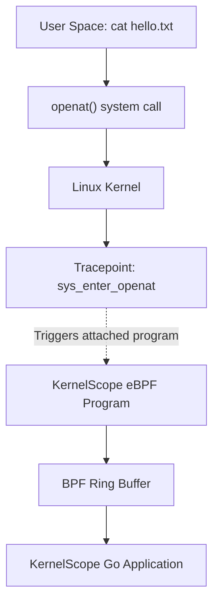

# Tracepoints

A **tracepoint is a predefined observation point inside the Linux kernel** where you can attach an eBPF program to execute when a particular event occurs.

Think of a tracepoint as a **sensor installed inside the Linux kernel**.

- The Linux kernel provides the sensor.
- Your eBPF program attaches to it.
- When the event occurs, the kernel executes your eBPF program.

Tracepoints are defined in the kernel source code, so you don't need to modify the kernel to use them.

## 1. How Tracepoints Work

Let's use our **KernelScope file monitor** as an example.

When you execute:

```bash
cat hello.txt
```

The `cat` program typically invokes the `openat()` system call to open the file.

### Execution Flow



### What Happens?

1. `cat` calls the `openat()` syscall.
2. Linux reaches the `sys_enter_openat` tracepoint.
3. The kernel executes our attached eBPF program.
4. Our program captures the PID, process name, and filename.
5. The event is sent to the Go application through the BPF ring buffer.

> [!tip]
> The tracepoint already exists in the kernel. We only attach our eBPF program to it.

## 2. Understanding the Tracepoint Name

In our `file.bpf.c`:

```c
SEC("tracepoint/syscalls/sys_enter_openat")
int trace_openat(struct trace_event_raw_sys_enter *ctx)
{
    // Our eBPF code
    return 0;
}
```

Let's break down the section name:

| Component          | Meaning                                  |
| ------------------ | ---------------------------------------- |
| `tracepoint`       | Type of eBPF attachment                  |
| `syscalls`         | Tracepoint category                      |
| `sys_enter_openat` | Event triggered when entering `openat()` |

The `SEC()` macro places the function in a named ELF section.

Our Go loader then explicitly attaches it:

```go
tp, err := link.Tracepoint(
    "syscalls",
    "sys_enter_openat",
    objs.TraceOpenat,
    nil,
)
```

The `link.Tracepoint()` function connects the loaded eBPF program to the kernel tracepoint.

### Key Understanding

- `SEC()` identifies the program's ELF section and attachment type.
- `syscalls` identifies the tracepoint category.
- `sys_enter_openat` identifies the kernel event.
- `link.Tracepoint()` performs the actual attachment from Go.

## 3. Different Tracepoints in Linux

Linux has many built-in tracepoints for observing different kernel activities.

| Tracepoint                    | What It Observes                                             |
| ----------------------------- | ------------------------------------------------------------ |
| `sched/sched_process_exec`    | A process successfully executes a program                    |
| `sched/sched_process_fork`    | A process or thread is created through a fork-like operation |
| `sched/sched_process_exit`    | A task exits                                                 |
| `syscalls/sys_enter_openat`   | A process attempts to open a file                            |
| `syscalls/sys_exit_openat`    | The `openat()` syscall returns                               |
| `syscalls/sys_enter_mkdirat`  | A process attempts to create a directory                     |
| `syscalls/sys_enter_unlinkat` | A process attempts to remove a filesystem entry              |

**Note:** Tracepoint availability depends on the Linux kernel and its configuration.

### Entry vs Exit Tracepoints

Consider an application opening a file:

```c
openat(AT_FDCWD, "/etc/passwd", O_RDONLY);
```

**`sys_enter_openat`**

The syscall is starting.

You can inspect its arguments, such as:

- Filename
- File-opening flags
- Directory file descriptor

**`sys_exit_openat`**

The syscall is finishing.

You can inspect its return value to determine whether the operation succeeded or failed.

For example:

- A non-negative return value indicates a file descriptor was returned.
- A negative return value indicates an error.

This is useful for KernelScope because our current tracer only captures **file-open attempts**.

To report successful and failed opens accurately, we need to correlate syscall entry and exit events.

## 4. Where Can You Find Tracepoints?

On your Rocky Linux VM, run:

```bash
sudo cat /sys/kernel/tracing/available_events
```

To find filesystem-related tracepoints:

```bash
sudo grep -E 'openat|mkdirat|unlinkat' \
  /sys/kernel/tracing/available_events
```

Example output:

```text
syscalls:sys_enter_openat
syscalls:sys_exit_openat
syscalls:sys_enter_mkdirat
syscalls:sys_exit_mkdirat
syscalls:sys_enter_unlinkat
syscalls:sys_exit_unlinkat
```

You can also inspect what information a tracepoint provides:

```bash
sudo cat \
  /sys/kernel/tracing/events/syscalls/sys_enter_openat/format
```

The `format` file describes the event fields, their types, sizes, and offsets.

These details help us understand the data available to an attached eBPF program.

## 5. Tracepoint vs Kprobe

Both mechanisms allow you to observe kernel activity, but they work differently.

| Feature             | Tracepoint                      | Kprobe                                  |
| ------------------- | ------------------------------- | --------------------------------------- |
| Attachment location | Predefined kernel event         | Kernel function or instruction location |
| Stability           | Generally more stable           | More dependent on kernel implementation |
| Available locations | Limited to existing tracepoints | More flexible                           |
| Best for            | Known events and syscalls       | Investigating internal kernel functions |
| KernelScope usage   | File and process monitoring     | Advanced debugging later                |

### Recommendation for KernelScope

Use **tracepoints first**.

They are easier to understand, generally provide more stable attachment points, and are well suited to KernelScope's initial observability features.

## 6. A Small Experiment on Rocky Linux

Try discovering which directory-creation tracepoints exist:

```bash
sudo grep mkdir /sys/kernel/tracing/available_events
```

Then inspect:

```bash
sudo cat \
  /sys/kernel/tracing/events/syscalls/sys_enter_mkdirat/format
```

Look for fields such as:

- `filename` — the user-space pointer to the directory path
- `mode` — the requested directory permission bits

These describe information available when `mkdirat()` is invoked.

You can then compare these fields with the arguments exposed by `sys_enter_openat`.

**Important:** A filename argument is usually a pointer to user-space memory, not a filename string stored directly in the tracepoint context. An eBPF program can use helpers such as `bpf_probe_read_user_str()` to read the string safely.

## 7. Key Takeaways

- A tracepoint is a predefined kernel event hook.
- It is not a separate process or file.
- An eBPF program can attach to a tracepoint without modifying kernel source code.
- The kernel executes the attached eBPF program whenever the event occurs.
- Entry tracepoints capture syscall arguments.
- Exit tracepoints provide syscall return values.
- Tracepoints are useful for file monitoring, process monitoring, and system observability.

### What's Next for KernelScope?

Our next learning milestone is understanding **tracepoint context (`ctx`)**.

The context provides access to syscall arguments and event information.

For example:

```c
SEC("tracepoint/syscalls/sys_enter_openat")
int trace_openat(struct trace_event_raw_sys_enter *ctx)
{
    // ctx->args[0] = directory file descriptor
    // ctx->args[1] = filename pointer
    // ctx->args[2] = flags
    // ctx->args[3] = mode

    return 0;
}
```

The next step is learning how to safely extract these arguments from `ctx` and use them in our eBPF program.
